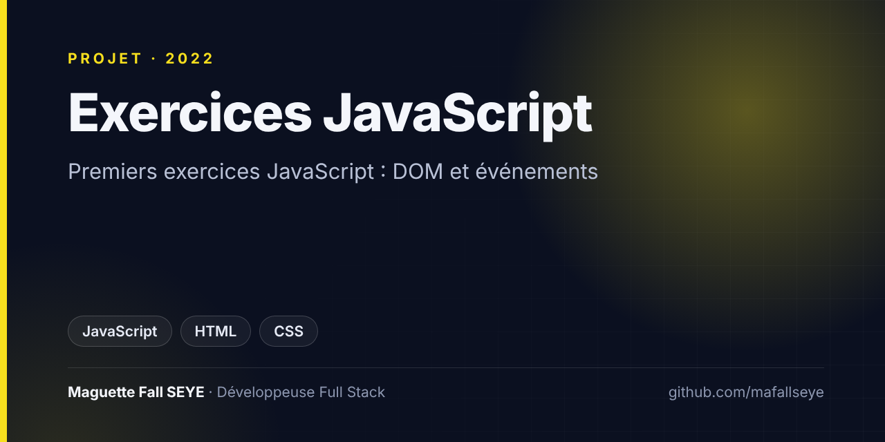

# Exercices JavaScript

Premiers exercices JavaScript : DOM et événements.

## Fonctionnalités

- Manipulation du DOM
- Gestion des événements

## Technologies

JavaScript · HTML · CSS

## Lancer le projet

Ouvrir `exo.html` dans un navigateur.

> Projet réalisé en 2022 pendant ma formation. Il est conservé ici comme trace de mon parcours.

## Auteure

**Maguette Fall SEYE** — Développeuse Full Stack, Dakar (Sénégal) · [github.com/mafallseye](https://github.com/mafallseye)
